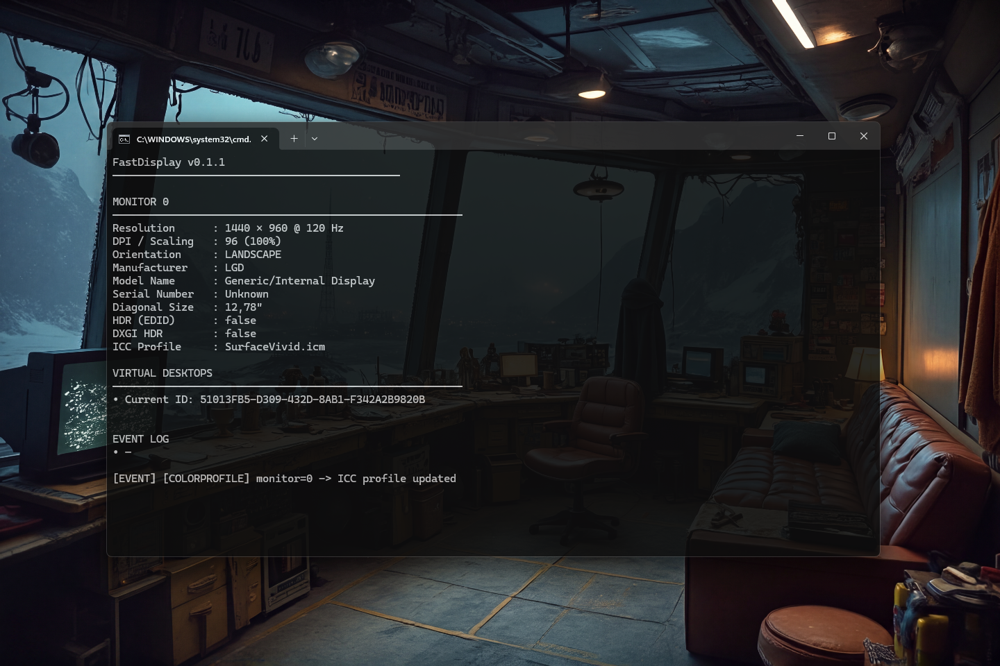

# FastDisplay 0.1.2 — Native Display & Windows OS Theme Monitoring API for Java

[](https://github.com/andrestubbe/FastDisplay/releases/tag/0.1.2)
[](https://opensource.org/licenses/MIT)
[](https://www.java.com)
[]()
[](https://jitpack.io/#andrestubbe/FastDisplay)

---

**🖥️ High-performance display and OS environment telemetry for the FastJava ecosystem. Monitor resolution, DPI scaling, refresh rates, orientation, and Windows OS theme/accent color changes with zero latency.**

**FastDisplay** is the dedicated display and environment monitoring module of the FastJava ecosystem. It provides real-time events for display and OS changes, allowing your Java application to respond instantly to resolution shifts, DPI scaling updates, and system-wide Dark/Light mode transitions via native Win32 callbacks and kernel event signals.

[](https://youtu.be/suxi7OLh1sk)

---

## Quick Start

```java
import fastdisplay.FastDisplay;
import fastdisplay.FastDisplay.MonitorInfo;
import fastdisplay.FastDisplay.Orientation;

public class QuickStart {
    public static void main(String[] args) {
        FastDisplay display = new FastDisplay();

        // 1. Enumerate all active displays
        MonitorInfo[] monitors = display.enumerateMonitors();
        for (MonitorInfo m : monitors) {
            System.out.printf("Monitor #%d: %dx%d @ %d Hz (DPI: %d)%n",
                    m.index, m.width, m.height, m.refreshRate, m.dpi);
        }

        // 2. Query Windows OS Theme State directly
        System.out.println("Dark Mode (Apps)  : " + display.isAppDarkMode());
        System.out.println("Dark Mode (System): " + display.isSystemDarkMode());
        System.out.printf("Accent Color       : #%08X%n", display.getAccentColor());

        // 3. Register real-time event listener
        display.setListener(new FastDisplay.DisplayListener() {
            @Override
            public void onInitialState(int width, int height, int dpi, int refreshRate, Orientation orientation) {
                System.out.println("Display initialized: " + width + "x" + height + " @ " + dpi + " DPI");
            }

            @Override
            public void onResolutionChanged(int monitorIndex, int width, int height, int dpi, int refreshRate) {
                System.out.printf("Monitor #%d resolution changed: %dx%d @ %d Hz%n", monitorIndex, width, height, refreshRate);
            }

            @Override
            public void onDPIChanged(int monitorIndex, int dpi, int scalePercent) {
                System.out.printf("Monitor #%d DPI changed: %d (%d%%)%n", monitorIndex, dpi, scalePercent);
            }

            @Override
            public void onOrientationChanged(int monitorIndex, Orientation orientation) {
                System.out.printf("Monitor #%d orientation: %s%n", monitorIndex, orientation);
            }

            @Override
            public void onColorProfileChanged(int monitorIndex) {
                System.out.printf("Monitor #%d ICC color profile updated%n", monitorIndex);
            }

            @Override
            public void onThemeChanged(boolean isDark, int accentColor) {
                System.out.printf("[THEME EVENT] Mode: %s | Accent: #%08X%n", (isDark ? "DARK" : "LIGHT"), accentColor);
            }
        });

        // 4. Start native message loop thread
        display.startMonitoring();
    }
}
```

---

## Table of Contents

- [Why FastDisplay?](#why-fastdisplay)
- [Quick Start](#quick-start)
- [Key Features](#key-features)
- [Real-World Use Cases](#real-world-use-cases)
- [Performance Benchmarks](#performance-benchmarks)
- [API Quick Reference](#api-quick-reference)
- [Technical Demos & Benchmarks](#technical-demos--benchmarks)
- [Installation](#installation)
- [Documentation](#documentation)
- [Platform Support](#platform-support)
- [License](#license)
- [Related Projects](#related-projects)

---

## Why FastDisplay?

Standard Java AWT / Swing (`GraphicsEnvironment`, `Toolkit`) methods for screen inspection are plagued by fundamental architectural drawbacks:

- **No Event Hooks**: Standard AWT provides no notification when the user changes DPI scaling, moves a window across monitors of differing DPIs, or switches display resolution. Applications are forced to resort to costly periodic polling loops.
- **Outdated Win32 DPI Model**: AWT often queries global metrics cached at JVM startup, failing to adapt when monitors are unplugged, dynamic display scaling is altered, or per-monitor v2 DPI scaling applies.
- **No Hardware Telemetry**: Native capabilities like EDID blocks (vendor, model name, physical dimensions, serial numbers), DXGI HDR active states, and ICC color profile associations are completely inaccessible via standard Java SE APIs.
- **No Native OS Theme Integration**: Java has no built-in mechanism to listen for Windows Dark/Light mode or accent color changes in real time.

**FastDisplay** fixes this by communicating directly with the Windows display subsystem:

- **Zero-Latency Win32 Callbacks**: Creates a lightweight, message-only window thread intercepting `WM_DISPLAYCHANGE`, `WM_DPICHANGED`, and color management messages as they happen with zero JVM polling overhead.
- **Instant Windows Theme & Accent Color Monitoring**: Uses direct kernel event notifications via `RegNotifyChangeKeyValue` and `MsgWaitForMultipleObjectsEx` combined with `WM_THEMECHANGED` to detect Dark/Light mode and accent color switches without dummy windows or polling.
- **Hardware-Level EDID Parsing**: FastDisplay extracts raw EDID byte arrays directly from device registry blocks and decodes vendor names, serials, and physical screen dimensions at sub-microsecond speeds.
- **Per-Monitor HDR & Color Profile Awareness**: Direct DXGI integration for instant HDR detection and ICC profile path discovery.
- **Virtual Desktops Integration**: Query and coordinate across Windows 10/11 Virtual Desktops via the integrated `FastDesktop` sister API.

| Feature | Java AWT / Swing | JavaFX Screen API | FastDisplay |
|:---|:---|:---|:---|
| **DPI Event Notification**| Polling only (No native event)| Static pulse / delayed | **Instant `WM_DPICHANGED` Win32 callback** |
| **Windows Theme Listening**| Not supported | Not supported | **Instant kernel signal & callback (`onThemeChanged`)** |
| **Per-Monitor v2 DPI** | Global cached metrics | Partial scaling queries | **True Per-Monitor v2 High-DPI** |
| **Hardware EDID Telemetry**| Not supported | Not supported | **Raw EDID byte parser (PNP, serials)** |
| **DXGI HDR & Color Profiles**| Not supported | Not supported | **Direct DXGI HDR & ICC profile path** |

---

## Key Features

- **📊 Real-Time Telemetry**: Instant capture of resolution, per-monitor DPI, refresh rate (Hz), and display orientation.
- **🌓 Windows Theme & Accent Color Monitoring**: Real-time event notifications and direct queries (`isAppDarkMode()`, `isSystemDarkMode()`, `getAccentColor()`).
- **🔔 Native Event Loop**: Dedicated background Win32 message pump with kernel event handles (`RegNotifyChangeKeyValue`) for instant dispatch.
- **🖥️ Multi-Monitor Enumeration**: Detailed snapshot of all displays currently active on the desktop grid.
- **🌈 EDID & HDR Capabilities**: Hardware-level parsing of EDID blocks, DXGI HDR status, and ICC color profile extraction.
- **🪟 Virtual Desktops**: Integration with Windows Task View / Virtual Desktop manager via `FastDesktop`.
- **⏱️ Zero Overhead**: Minimalist JNI layer with direct pinned buffers and zero polling.

---

## Real-World Use Cases

- 🌓 **Dynamic Theme Switching** — Automatically transition Swing/JavaFX application themes between Light and Dark mode and harmonize accent colors in real time when Windows theme settings change.
- 🖥️ **Dynamic Per-Monitor DPI Adaptation** — Instantly rescale UI layouts, fonts, vector icons, and coordinate systems when an application window is dragged between a 4K 200% laptop screen and a 1080p 100% desktop monitor without blurry OS scaling.
- 🎨 **Color-Critical & HDR Workflows** — Automatically switch rendering pipelines (sRGB vs. DCI-P3 / BT.2020) and load correct monitor ICC color profiles when HDR mode is enabled or active displays change.
- 🎮 **Adaptive High-Refresh Gaming & Animation** — Detect physical panel refresh rates (60 Hz, 120 Hz, 144 Hz, 240 Hz) in real-time to adjust VSync target frames and orchestrate `FastAnimation` / `FastTween` timers accordingly.
- 🪟 **Multi-Monitor Window & Desktop Tiling** — Query precise work areas, physical screen coordinates, and virtual desktop IDs to build autonomous window managers, HUD overlays, and cross-monitor workspace snapping.
- 📺 **Digital Signage & Display Telemetry Auditing** — Read raw EDID descriptors (manufacturer PNP codes, serial numbers, native panel resolution, and diagonal inches) directly from graphics drivers for system diagnostic utilities.

---

## Performance Benchmarks

FastDisplay's parsing and telemetry pipelines are benchmarked using **JMH** to guarantee microsecond-level execution and zero garbage collector pressure:

| Benchmark Operation | Score (ops/ms) | Throughput (Ops/sec) |
|---|---|---|
| **FastDisplayUtils.parseManufacturer** (EDID) | ~105,383 ops/ms | **> 105.3 Million / sec** |
| **FastDisplayUtils.parseModelName** (EDID) | ~13,985 ops/ms | **> 13.9 Million / sec** |

*Measured on Windows 11 (x64), Intel Core i5-1135G7 (Surface Pro 8), JDK 21.0.12, JMH 1.37 in Throughput mode.*

---

## API Quick Reference

### `FastDisplay` (Native Display Subsystem)

| Method | Return Type | Description | Docs |
|---|---|---|---|
| `enumerateMonitors()` | `MonitorInfo[]` | Returns immutable snapshot array of all connected physical displays. | [Reference](docs/REFERENCE.md#1-class-fastdisplayfastdisplay) |
| `setListener(listener)` | `void` | Registers a callback listener for resolution, DPI, orientation, color, and theme events. | [Reference](docs/REFERENCE.md#1-class-fastdisplayfastdisplay) |
| `startMonitoring()` | `boolean` | Starts the dedicated background Win32 message-only window thread. | [Reference](docs/REFERENCE.md#1-class-fastdisplayfastdisplay) |
| `stopMonitoring()` | `void` | Stops the background message pump and releases native resources (idempotent). | [Reference](docs/REFERENCE.md#1-class-fastdisplayfastdisplay) |
| `isAppDarkMode()` | `boolean` | Returns whether Windows Apps are configured to use Dark Mode. | [Reference](docs/REFERENCE.md#1-class-fastdisplayfastdisplay) |
| `isSystemDarkMode()` | `boolean` | Returns whether Windows System (taskbar/shell) is in Dark Mode. | [Reference](docs/REFERENCE.md#1-class-fastdisplayfastdisplay) |
| `getAccentColor()` | `int` | Returns current Windows accent color as ARGB integer (`0xAARRGGBB`). | [Reference](docs/REFERENCE.md#1-class-fastdisplayfastdisplay) |
| `getResolution()` | `int[]` | Returns `[width, height]` of primary display in pixels. | [Reference](docs/REFERENCE.md#1-class-fastdisplayfastdisplay) |
| `getScale()` | `int` | Returns current primary scaling factor (e.g. 100, 125, 150, 200). | [Reference](docs/REFERENCE.md#1-class-fastdisplayfastdisplay) |
| `getOrientation()` | `Orientation` | Returns primary screen rotation (`LANDSCAPE`, `PORTRAIT`, etc.). | [Reference](docs/REFERENCE.md#1-class-fastdisplayfastdisplay) |
| `isHdrEnabled(monitorIndex)` | `boolean` | Checks whether DXGI HDR rendering is active on the given display. | [Reference](docs/REFERENCE.md#1-class-fastdisplayfastdisplay) |
| `getColorProfileForMonitor(monitorIndex)` | `String` | Returns path or identifier of active ICC/ICM color profile via WCS. | [Reference](docs/REFERENCE.md#1-class-fastdisplayfastdisplay) |
| `getEdidForMonitor(monitorIndex)` | `byte[]` | Extracts the raw 128/256-byte binary EDID hardware descriptor block. | [Reference](docs/REFERENCE.md#1-class-fastdisplayfastdisplay) |
| `setBrightness(monitorIndex, percent)` | `boolean` | Adjusts monitor hardware backlight via DDC/CI (0–100%). | [Reference](docs/REFERENCE.md#1-class-fastdisplayfastdisplay) |

### `FastDesktop` (Windows 10/11 Virtual Desktops)

| Method | Return Type | Description | Docs |
|---|---|---|---|
| `enumerateDesktops()` | `DesktopInfo[]` | Returns all open virtual desktops with GUIDs and names. | [Reference](docs/REFERENCE.md#2-class-fastdisplayfastdesktop) |
| `getCurrentDesktopId()` | `String` | Returns the GUID of the currently active virtual desktop. | [Reference](docs/REFERENCE.md#2-class-fastdisplayfastdesktop) |
| `switchDesktop(desktopId)` | `boolean` | Switches desktop view to the specified virtual desktop GUID. | [Reference](docs/REFERENCE.md#2-class-fastdisplayfastdesktop) |
| `moveWindowToDesktop(hwnd, desktopId)` | `boolean` | Migrates a native Win32 window handle (`HWND`) to target virtual desktop. | [Reference](docs/REFERENCE.md#2-class-fastdisplayfastdesktop) |
| `setListener(listener)` | `void` | Subscribes to desktop creation, deletion, and switch events. | [Reference](docs/REFERENCE.md#2-class-fastdisplayfastdesktop) |

### `FastDisplayUtils` (EDID Decoders & Diagnostics)

| Method | Return Type | Description | Docs |
|---|---|---|---|
| `parseManufacturer(edid)` | `String` | Decodes 3-letter PNP vendor code (e.g. `DEL`, `SAM`, `LG`). | [Reference](docs/REFERENCE.md#3-class-fastdisplayfastdisplayutils) |
| `parseModelName(edid)` | `String` | Extracts ASCII monitor model name descriptor from descriptor blocks. | [Reference](docs/REFERENCE.md#3-class-fastdisplayfastdisplayutils) |
| `parseSerialNumber(edid)` | `String` | Extracts monitor physical serial number string from EDID. | [Reference](docs/REFERENCE.md#3-class-fastdisplayfastdisplayutils) |
| `parseSizeInInches(edid)` | `double` | Computes physical diagonal screen size in inches from cm dimensions. | [Reference](docs/REFERENCE.md#3-class-fastdisplayfastdisplayutils) |
| `parseNativeWidth/Height(edid)` | `int` | Extracts preferred native panel pixel resolution from Detailed Timings. | [Reference](docs/REFERENCE.md#3-class-fastdisplayfastdisplayutils) |
| `parseHdrCapabilities(edid)` | `Map<String, Boolean>` | Parses CTA-861 extension blocks for HDR, PQ, and HLG luminance metadata. | [Reference](docs/REFERENCE.md#3-class-fastdisplayfastdisplayutils) |
| `formatMonitorReport(m, edid, hdr, icc)` | `String` | Generates a clean ASCII diagnostic report for terminal display. | [Reference](docs/REFERENCE.md#3-class-fastdisplayfastdisplayutils) |

---

## Technical Demos & Benchmarks

| Case | Java Example | Launcher | Description |
|---|---|---|---|
| **Theme & Accent Color Listener** | [ThemeListenerDemo.java](examples/Demo/src/main/java/fastdisplay/ThemeListenerDemo.java) | `run-demo-theme-listener.bat` | Real-time console demo monitoring Windows Dark/Light mode and accent color switches without dummy windows. |
| **Display Telemetry & Event Monitor** | [Demo.java](examples/Demo/src/main/java/fastdisplay/Demo.java) | `run-demo.bat` | Live CLI monitor enumerating displays, EDID blocks, HDR status, Virtual Desktops, and event callbacks. |
| **JMH Microbenchmark Suite** | [Benchmark.java](examples/Benchmark/src/main/java/fastdisplay/benchmark/Benchmark.java) | `run-benchmark.bat` | OpenJDK JMH microbenchmarks measuring raw EDID manufacturer and model descriptor parsing throughput. |

---

## Installation

### Option 1: Maven (Recommended)

Add the JitPack repository and the dependency to your `pom.xml`:

```xml
<repositories>
    <repository>
        <id>jitpack.io</id>
        <url>https://jitpack.io</url>
    </repository>
</repositories>

<dependencies>
    <dependency>
        <groupId>com.github.andrestubbe</groupId>
        <artifactId>FastDisplay</artifactId>
        <version>0.1.2</version>
    </dependency>
    <!-- Unified Native JNI Loader -->
    <dependency>
        <groupId>com.github.andrestubbe</groupId>
        <artifactId>FastCore</artifactId>
        <version>0.1.0</version>
    </dependency>
</dependencies>
```

### Option 2: Gradle (via JitPack)

```groovy
repositories {
    maven { url 'https://jitpack.io' }
}

dependencies {
    implementation 'com.github.andrestubbe:FastDisplay:0.1.2'
    implementation 'com.github.andrestubbe:FastCore:0.1.0'
}
```

### Option 3: Direct Download (No Build Tool)

Download the pre-built JARs directly to add them to your classpath:

1. 📦 **[FastDisplay-0.1.2.jar](https://github.com/andrestubbe/FastDisplay/releases/download/0.1.2/FastDisplay-0.1.2.jar)** (The Core Library)
2. ⚙️ **[FastCore-0.1.0.jar](https://github.com/andrestubbe/FastCore/releases/download/0.1.0/FastCore-0.1.0.jar)** (The Mandatory Native Loader)

---

## Documentation

* **[COMPILE.md](docs/COMPILE.md)**: Full compilation guide (MSVC C++17 build chain + JNI Setup).
* **[REFERENCE.md](docs/REFERENCE.md)**: Full API descriptions, border configurations, and codepoint index.
* **[PHILOSOPHY.md](docs/PHILOSOPHY.md)**: The engineering rationale for zero-allocation performance.
* **[ROADMAP.md](docs/ROADMAP.md)**: Future milestones and planned features.
* **[CHANGELOG.md](docs/CHANGELOG.md)**: Release history and version migration notes.

---

## Platform Support

| Platform | Status | Notes |
|---|---|---|
| **Windows 10 / 11 (x64)** | ✅ Fully Supported | Win32 message loop, Theme/Dark mode listening, per-monitor v2 DPI, DXGI HDR, EDID |
| **Linux (X11 / Wayland)** | 🔗 Planned | Native XRandR / Wayland protocol integration |
| **macOS (Apple Silicon / Intel)** | 🔗 Planned | CoreGraphics display reconfiguration callbacks |

---

## License

MIT License — See [LICENSE](LICENSE) file for details.

---

## Related Projects

- [FastCore](https://github.com/andrestubbe/FastCore) — Unified JNI loader and platform abstraction
- [FastDWM](https://github.com/andrestubbe/FastDWM) — Native Desktop Window Manager API & backdrop effects
- [FastTheme](https://github.com/andrestubbe/FastTheme) — High-performance native window styling
- [FastAnimation](https://github.com/andrestubbe/FastAnimation) — Ultra-fast native animation engine for Java
- [FastTween](https://github.com/andrestubbe/FastTween) — Zero-overhead interpolation engine

---

**Part of the FastJava Ecosystem** — *Making the JVM faster.* 🚀
